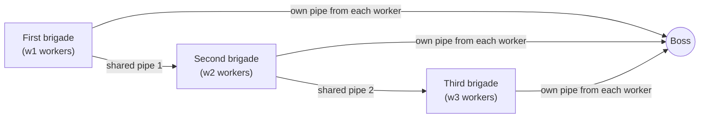

# L5: The Factory

*Topic: L5 — FIFO/pipe*

The Company plans to create a new Factory producing Things. To calculate the profitability of the whole investment, they ask you to create a simulation. In the Factory, resources are taken from the warehouse and then go through the three-stage production line. The whole process is overseen by the Boss. That's all you need to know.

*(The original picture: three brigades drawn as ellipses; the workers of the first brigade write into one shared pipe read by the second brigade, the second brigade writes into one shared pipe read by the third brigade, and every worker of every brigade has its own arrow to the Boss.)*

## Stages

### Stage 1 (8 p.)

The program should parse three positional parameters - *w*₁, *w*₂, *w*₃ (1 ≤ *w*₁, *w*₂, *w*₃ ≤ 10) denoting the number of workers in the given brigade, working on one production stage. Create worker processes. Each of them should have an unnamed pipe to the Boss (parent) process, which should be opened for writing on the worker side and for reading on the Boss side. Create also two additional pipes - the first is shared between workers from the first (writing) and second (reading) brigades. The second one is shared between workers from the second (writing) and third (reading) brigades. The structure should be like the one in the picture above. Close all unused pipe ends. Each process should print its open descriptor count (use function `count_descriptors()`) and then end. The Boss process waits for all other processes and then also exits. *Hint:* It looks like that terminal emulator built into some IDEs like VS code opens some additional descriptors, so output may vary. To test the program, run it in a standalone terminal emulator.

### Stage 2 (4 p.)

Implement basic factory processing. Every 1 – 10 milliseconds worker from the first brigade generates a random capital letter (A-Z) and sends it through the pipe to the second brigade. When a worker from the second brigade receives a letter, it sleeps for 1 – 10 milliseconds and then sends 1 – 4 copies of that letter to the third brigade. A worker from a third brigade reads a new letter from the pipe every 1 – 3 milliseconds until he has five of them - then he prints resulting word and starts again.

### Stage 3 (9 p. ?)

The warehouse will be simulated by a FIFO named `warehouse`. Create it and pass it to the first brigade. They should read small letters (a-z) from the FIFO (instead of generating them, discard other characters), convert them to capital letters, and send them to the second brigade as usual. Use the terminal to provide input for the program, e.g. `$ cat /etc/group > warehouse`. *Reminder of the lecture:* Opening fifo in default mode waits until it is also opened for reading (e.g., by writing some data from another terminal).

### Stage 4 (4 p. ?)

When a worker finishes one job, he sends one byte to the Boss. Set those pipes in nonblocking mode and ignore them if you achieve pipe capacity.

### Stage 5 (5 p.)

After receiving `SIGINT`, the Boss counts bytes in each pipe, closes them, and prints a table with the number of jobs completed by each worker. Then it send `SIGINT` to all workers. After receiving `SIGINT` the worker ends its job - you should also handle `SIGPIPE` as it may come first.

---

